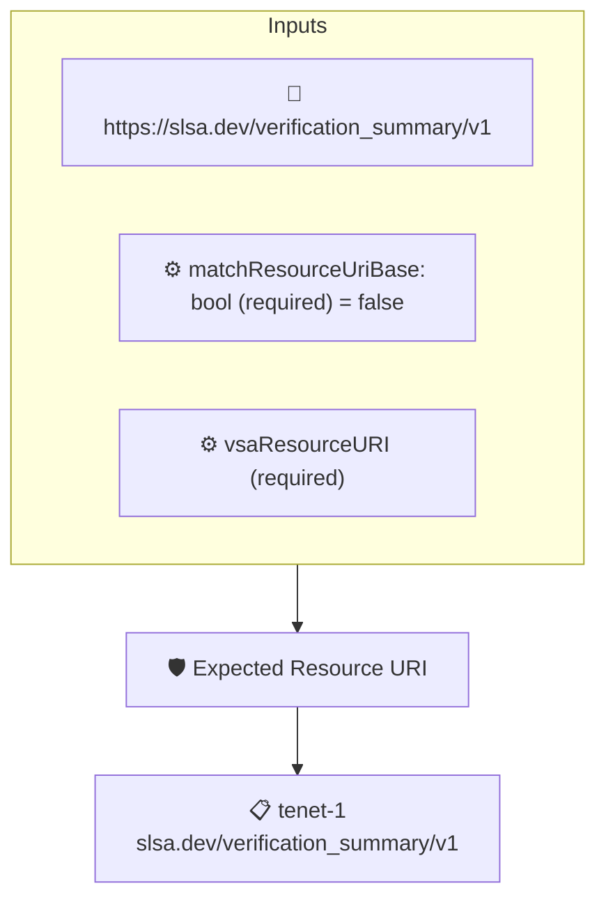

# Expected Resource URI

Checks that a SLSA Verification Summary Attestation verifies the expected resource, given as the `vsaResourceURI` context value, optionally matching it as a prefix.

## Overview

| Property | Value |
|----------|-------|
| **Type** | Policy |
| **ID** | `vsa-verify-resourceuri` |
| **Assert mode** | AND |
| **Tenets** | 1 |
| **Enforce** | ON |

## Context Values

| Name | Type | Required | Default |
|------|------|----------|---------|
| `matchResourceUriBase` | bool | **yes** | `false` |
| `vsaResourceURI` |  | **yes** |  |

## Structure



## Tenets

### Tenet: `tenet-1`

**Attestation types:**
- `https://slsa.dev/verification_summary/v1`

**Evaluation:**
```cel
outputs.resourceURI == context.vsaResourceURI || (outputs.resourceURI.startsWith(context.vsaResourceURI) && context.matchResourceUriBase )
```

**Outputs:**
- `resourceURI`: `has(predicates[0].data.resourceUri) ? predicates[0].data.resourceUri : '' `

**On pass:** VSA verification of expected resource URI

**On fail:** VSA not vierifying correct resource URI
**Guidance:** Expecting {{ .Context.vsaResourceURI }} got {{ .Outputs.resourceURI }}

