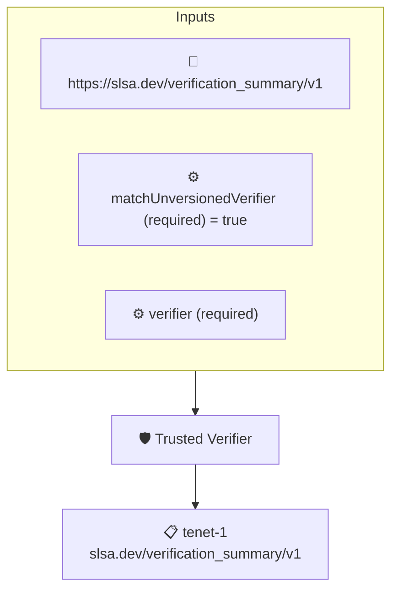

# Trusted Verifier

Checks that a SLSA Verification Summary Attestation was issued by the expected verifier, given as the `verifierId` context value, optionally ignoring the verifier's version.

## Overview

| Property | Value |
|----------|-------|
| **Type** | Policy |
| **ID** | `vsa-verify-verifier` |
| **Assert mode** | AND |
| **Tenets** | 1 |
| **Enforce** | ON |

## Context Values

| Name | Type | Required | Default |
|------|------|----------|---------|
| `matchUnversionedVerifier` |  | **yes** | `true` |
| `verifier` |  | **yes** |  |

## Structure



## Tenets

### Tenet: `tenet-1`

**Attestation types:**
- `https://slsa.dev/verification_summary/v1`

**Evaluation:**
```cel
outputs.verifier == context.verifier || (outputs.verifier.startsWith(context.verifier + '@') && context.matchUnversionedVerifier )
```

**Outputs:**
- `verifier`: `has(predicates[0].data.verifier) ? ( has(predicates[0].data.verifier.id) ? pr...`

**On pass:** Attestation was issued by trusted verifier

**On fail:** Attestation NOT issued by trusted verifier
**Guidance:** Expecting {{ .Context.verifier }} got {{ .Outputs.verifier }}

